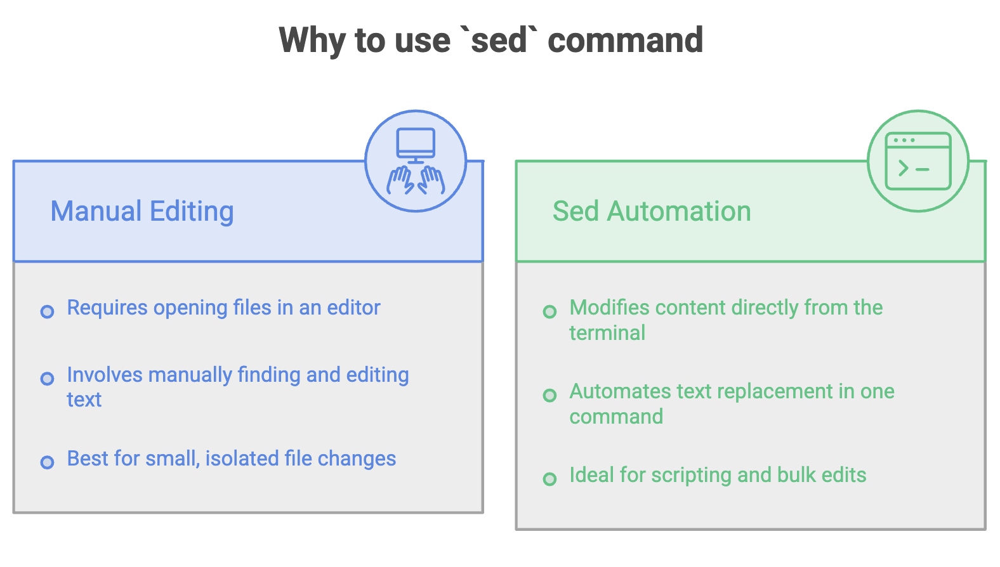

# Linux `sed` Command: Stream Editor

## What is `sed`?

**sed** stands for **Stream Editor**. It is a powerful command-line tool used to **process and modify text directly from the terminal** without opening the file in an editor (like `vi` or `nano`).

With `sed`, you can **find and replace text**, **delete lines**, and **insert new content** — all without ever opening the file.

### Basic Syntax

```bash
sed [options] 'command' filename
```

---



---

## Find & Replace Operations

### 1. Replace Text (Without Modifying the Original File)

```bash
sed 's/Telusko/TeluskoAI/' telusko.txt
```

- Replaces `Telusko` with `TeluskoAI` and **displays the output** on the terminal.
- The **original file is NOT changed** — this is a preview of the changes.
- The replacement is **case-sensitive**.
- Replaces only the **first occurrence** of the pattern on each line.


### 2. Replace Text in the Original File (`-i`)

```bash
sed -i 's/Telusko/TELUSKOAI/' telusko.txt
```

- The `-i` flag makes the changes **directly in the original file** (in-place editing).
- The original file **is modified permanently**.
- Replaces only the **first occurrence** of the pattern on each line.


### 3. Replace All Occurrences on Each Line (`g` flag)

```bash
sed -i 's/telusko/learn.telusko.com/g' telusko.txt
```

- The `g` (global) flag replaces **all occurrences** of the pattern on every line, not just the first one.
- Combined with `-i`, the changes are applied directly to the file.

---

## Delete Operations

### 1. Delete the Last Line (`$d`)

```bash
sed -i '$d' telusko.txt
```

- `$` refers to the **last line** of the file.
- `d` is the delete command.
- This removes the last line from the file.


### 2. Delete a Specific Line (`nd`)

```bash
sed -i '2d' telusko.txt
```

- Deletes the **2nd line** from the file.
- Replace `2` with any line number `n` to delete that specific line.

---

## Insert Operations

### 1. Insert Text at a Specific Line (`i\`)

```bash
sed -i '4i\telusko has recorded and live courses' telusko.txt
```

- Inserts the given text **at line 4** of the file.
- Existing content from line 4 onward is shifted down.


### 2. Append Text at the End of the File (`$a\`)

```bash
sed -i '$a\Muskan is also a part of the course' telusko.txt
```

- `$a\` appends the given text **after the last line** of the file.

---

## Quick Reference

| Command                                     | Description                                      |
|---------------------------------------------|--------------------------------------------------|
| `sed 's/old/new/' file`                     | Replace first occurrence per line (preview only)  |
| `sed -i 's/old/new/' file`                  | Replace first occurrence per line (modify file)   |
| `sed -i 's/old/new/g' file`                 | Replace all occurrences per line (modify file)    |
| `sed -i '$d' file`                          | Delete the last line                              |
| `sed -i 'nd' file`                          | Delete the nth line                               |
| `sed -i '4i\text' file`                     | Insert text at line 4                             |
| `sed -i '$a\text' file`                     | Append text at the end of the file                |

---

## Summary

- `sed` allows you to **edit files directly from the terminal** without opening them.
- Without `-i`, `sed` only **displays** the modified output — the original file remains unchanged.
- With `-i`, the changes are **applied directly** to the original file.
- Use the `g` flag to replace **all occurrences** on each line (not just the first).
- `sed` can **replace**, **delete**, and **insert** content — making it a versatile tool for text processing and automation.
