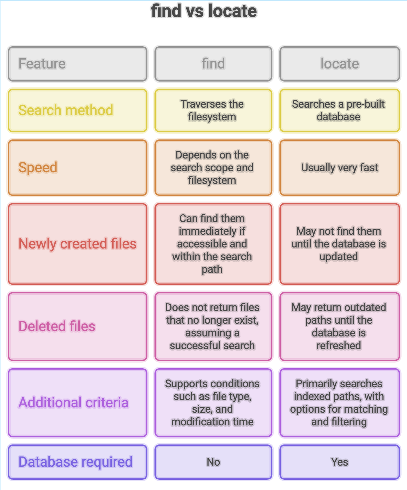

# Linux `locate` Command: Faster File Search

## What Is the `locate` Command?

The `locate` command helps you find files and directories quickly by searching a pre-built database of filesystem paths.

Unlike `find`, which searches through directories on the filesystem, `locate` looks up matching paths in an existing database. This makes it especially useful when you need to locate a file quickly on a system containing many files.

The main trade-off is that **search results depend on how recently the database was updated**.

### Installation

On Ubuntu systems, `locate` may not be installed by default. One commonly used implementation is `plocate`.

Install it with:

```bash
sudo apt update
sudo apt install plocate
```

Verify the installation:

```bash
locate --version
```

### Basic Syntax

```bash
locate [options] pattern
```

- **`options`** — Optional flags that control the search.
- **`pattern`** — The filename or text pattern to look for in stored paths.

---

## Common `locate` Commands

### 1. Search for a File

```bash
locate error.txt
```

Displays database entries whose paths match `error.txt`.

For example:

```text
/home/ubuntu/error.txt
/var/log/error.txt
```

The results show stored paths that match the search pattern. They do not guarantee that every listed file still exists on the filesystem.

**Note:** `locate error.txt` can match paths containing that text, not only files whose exact name is `error.txt`.

To match a filename more precisely, use:

```bash
locate -b '\error.txt'
```

The `-b` option matches the basename, and the escaped pattern treats the filename literally.

### 2. Count Matching Paths (`-c`)

Use `-c` to count matching database entries instead of printing each path.

```bash
locate -c telusko.txt
```

The output might be:

```text
3
```

This means three matching entries were found in the database. It does not necessarily mean that three matching files currently exist.

### 3. Search Without Considering Case (`-i`)

Use `-i` to ignore differences between uppercase and lowercase letters.

```bash
locate -i exception.txt
```

This can match paths containing names such as `exception.txt`, `Exception.txt`, or `EXCEPTION.TXT`.

---

## How Does the `locate` Database Work?

The `locate` utility uses an index of filesystem paths stored in a database, commonly maintained by a tool such as `updatedb`.

The process works as follows:

1. **Database creation or update:** The system scans eligible filesystem locations and records paths in the database.
2. **Search:** When you run `locate`, it searches the stored index.
3. **Results:** Matching paths are displayed without requiring a new directory-by-directory scan for every search.

This approach makes `locate` fast, but its results can become outdated when files are created, renamed, or deleted.

Database updates may be scheduled automatically, depending on the Linux distribution and system configuration.

---

## Updating the Database

Suppose you create a new file:

```bash
touch exception.txt
```

You then search for it:

```bash
locate exception.txt
```

If the database has not been updated since the file was created, the file may not appear in the results.

To refresh the database, run:

```bash
sudo updatedb
```

Then search again:

```bash
locate exception.txt
```

The updated database should now include the file, provided its directory is covered by the database configuration and accessible to the indexing process.

> You do not need to run `updatedb` after every file creation. Use it when you need to refresh the index and the expected result is missing.

---



---

## Summary
- `locate` is a fast way to search for files and directories by path.
- It searches an index rather than scanning the filesystem from scratch.
- Use `-c` to count matching paths and `-i` for case-insensitive searches.
- Run `sudo updatedb` when you need to refresh the database, subject to your system's configuration and permissions.
- Choose `locate` for speed and `find` when you need current filesystem results or more detailed search conditions.

**Remember:** `locate` prioritizes speed by searching an index, while `find` searches the filesystem directly.
