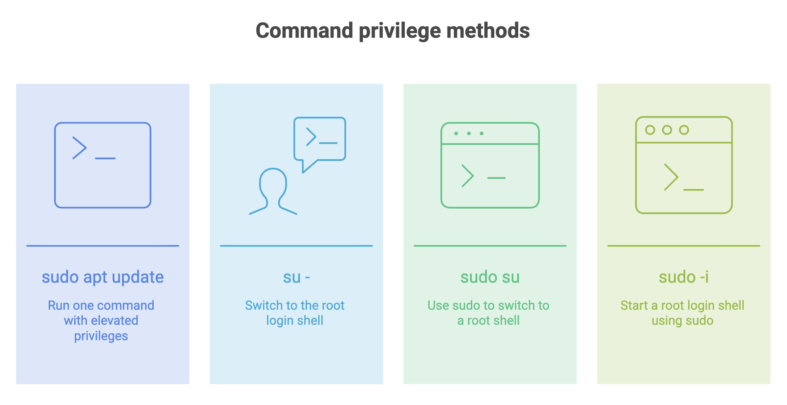

# Linux Root User, `sudo` & `su`

## What Is the Root User?

The **root user** is the superuser account in Linux. It has extensive administrative privileges to manage the system, including installing software, modifying system configurations, managing user accounts, and accessing protected files.

When connecting to a Linux server, such as an Ubuntu EC2 instance, you typically log in as a regular user (for example, `ubuntu`). This account has limited privileges to help protect the system from accidental or unauthorized changes.

Some administrative operations therefore require elevated privileges.

---

## Understanding Permission Denied

Consider running the following command as a regular user:

```bash
apt update
```

If the user does not have the required privileges, the command may fail with a permission error.

The `apt update` command refreshes the local package index, which requires administrative privileges because it updates system-managed package information.

You can run it with `sudo` instead.

---

## What Is `sudo`?

`sudo` allows an authorized user to execute a command with elevated privileges, commonly as the root user.

The name is commonly expanded as **Superuser Do**.

### Syntax

```bash
sudo command
```

### Example

```bash
sudo apt update
```

Here is what happens:

1. `sudo` requests permission to run the command with elevated privileges.
2. You may be prompted to enter your own user's password, depending on the system's configuration.
3. If authorized, the command executes with the requested privileges.
4. Your current login session remains under your regular user account.

Verify your user afterward:

```bash
whoami
```

Example output:

```text
ubuntu
```

**Key point:** `sudo` elevates privileges for a command without permanently switching your terminal session to root.

--

## What Is `su`?

The `su` command stands for **Switch User**. It allows you to switch to another user account in the current terminal session.

### 1. Switch to the Root User

```bash
su -
```

This attempts to start a root login shell. On many systems, you must provide the root account's password.

On Ubuntu, the root account is commonly locked for direct password-based login by default. If your account has permission to use `sudo`, you can start a root shell with:

```bash
sudo su
```

Alternatively, the following command is commonly preferred for starting a root login shell:

```bash
sudo -i
```

### 2. Verify the Current User

Use `whoami` to check which account is active:

```bash
whoami
```

Example output after switching to root:

```text
root
```

Your terminal prompt may also change, often ending in `#` instead of `$`. However, prompt appearance depends on the shell configuration, so use `whoami` when you need to confirm the current user.

### 3. Exit the Root Session

When you finish your administrative work, run:

```bash
exit
```

This closes the root shell and returns you to the previous user session.

You can verify this with:

```bash
whoami
```

Example output:

```text
ubuntu
```

## `sudo` vs `su` vs `sudo su`



> For routine administration, prefer `sudo` for individual commands. Use a root shell only when you need to execute several administrative commands and understand the risks.

---

## Best Practices

- **Use least privilege:** Run commands with elevated privileges only when necessary.
- **Prefer `sudo` for individual tasks:** It reduces the chance of accidentally running unrelated commands as root.
- **Be careful with destructive commands:** Commands executed as root can modify or delete important system files.
- **Verify your identity:** Run `whoami` if you are unsure which user is active.
- **Exit when finished:** Leave the root shell with `exit` as soon as your administrative work is complete.

---

## Summary

- The root user has extensive administrative privileges across the Linux system.
- `sudo` runs an authorized command with elevated privileges while keeping your current user session unchanged.
- `su` switches to another user; `su -` starts a login shell for that user.
- `sudo su` and `sudo -i` can provide a root shell when the current user is authorized.
- Use `whoami` to identify the current user and `exit` to leave a shell session.

**Remember:** Use `sudo` for individual administrative commands whenever possible, and avoid remaining in a root shell longer than necessary.
